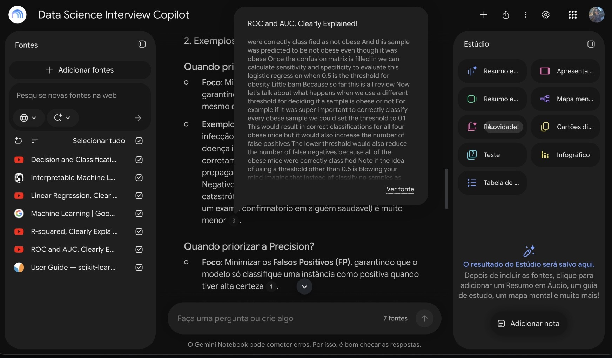
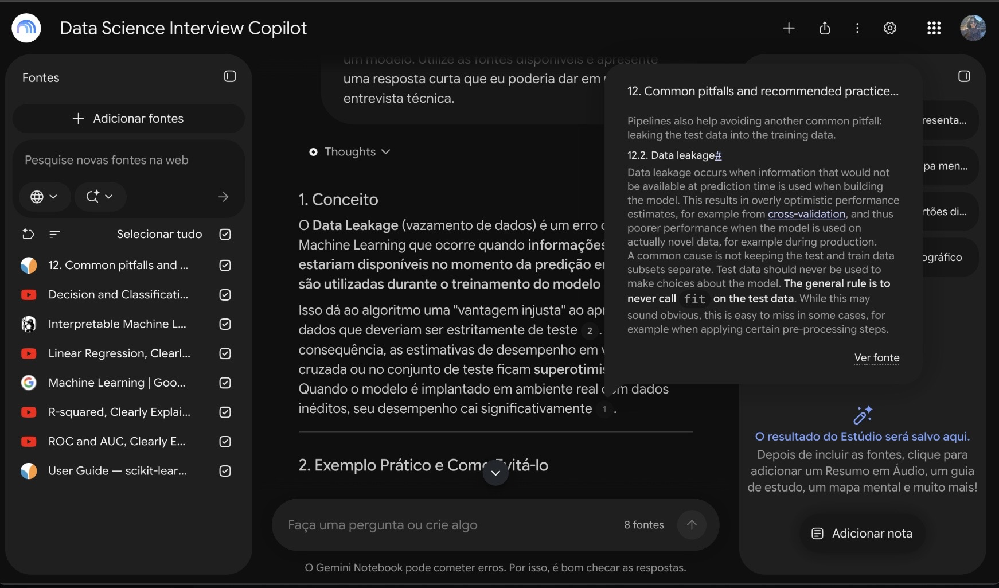
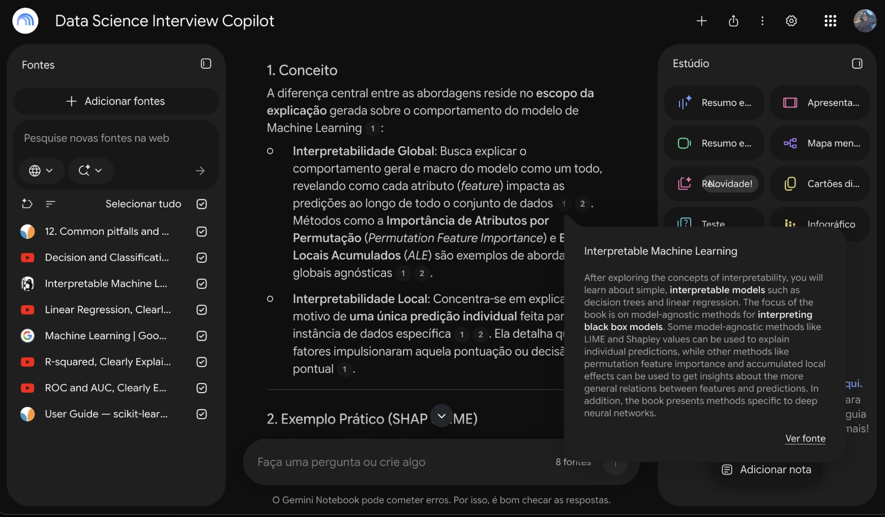
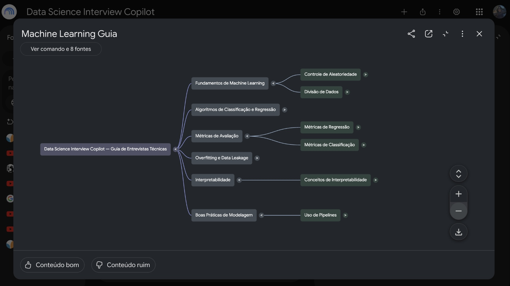

# 🧠 Data Science Interview Copilot

### Assistente de estudos com IA para entrevistas técnicas de Ciência de Dados

## 📌 Sobre o projeto

O **Data Science Interview Copilot** é um assistente de estudos desenvolvido com o Google NotebookLM, utilizando Inteligência Artificial Generativa e uma base de conhecimento composta por fontes técnicas selecionadas.

O projeto foi criado para apoiar estudantes e profissionais em início de carreira na preparação para entrevistas técnicas de Ciência de Dados e Machine Learning.

Diferentemente de um chatbot de propósito geral, o assistente utiliza as fontes adicionadas ao notebook como base para suas respostas, permitindo consultar citações e verificar a origem das informações.

### 🎯 Objetivo

Construir um segundo cérebro com IA capaz de:

- Explicar conceitos fundamentais de Ciência de Dados e Machine Learning.
- Auxiliar na preparação para entrevistas técnicas.
- Apresentar exemplos práticos de aplicação dos conceitos.
- Responder perguntas utilizando fontes verificáveis.
- Gerar materiais de revisão, como mapas mentais e apresentações.

## 🛠️ Tecnologias utilizadas

| Tecnologia | Aplicação |
|---|---|
| Google NotebookLM | Assistente de conhecimento baseado em fontes |
| Inteligência Artificial Generativa | Síntese e explicação de conteúdos |
| Retrieval-Augmented Generation (RAG) | Abordagem de recuperação de informações para fundamentar respostas |
| GitHub | Documentação e disponibilização do projeto |
| Markdown | Organização da documentação |

## 📚 Base de conhecimento

O notebook foi construído com oito fontes de conhecimento, incluindo documentação oficial, livro técnico e vídeos educacionais.

| Fonte | Tipo | Justificativa |
|---|---|---|
| [Scikit-learn — User Guide](https://scikit-learn.org/stable/user_guide.html) | Documentação | Referência oficial para algoritmos e avaliação de modelos |
| [Scikit-learn — Common Pitfalls](https://scikit-learn.org/stable/common_pitfalls.html) | Documentação | Orientações sobre Data Leakage e boas práticas |
| [Google Machine Learning Crash Course](https://developers.google.com/machine-learning/crash-course) | Conteúdo educacional | Material desenvolvido pelo Google para ensinar fundamentos de ML |
| [Interpretable Machine Learning](https://christophm.github.io/interpretable-ml-book/) | Livro técnico | Referência de Christoph Molnar sobre interpretabilidade |
| StatQuest — Decision and Classification | YouTube | Explicações didáticas de classificação |
| StatQuest — Linear Regression, Clearly Explained! | YouTube | Fundamentos de regressão linear |
| StatQuest — R-squared, Clearly Explained! | YouTube | Avaliação de modelos de regressão |
| StatQuest — ROC and AUC, Clearly Explained! | YouTube | Avaliação de classificadores |

As fontes foram selecionadas considerando credibilidade, relevância técnica, clareza e complementaridade.

A inclusão de materiais em diferentes formatos permite reunir explicações conceituais, documentação técnica e exemplos educacionais.

## ⚙️ Configuração do especialista

O notebook foi configurado para atuar como um **Cientista de Dados Sênior e mentor de preparação para entrevistas técnicas**.

A diretriz personalizada estabelece que o assistente deve:

- Responder em português do Brasil.
- Utilizar linguagem clara e tecnicamente rigorosa.
- Fundamentar as respostas nas fontes disponíveis.
- Apresentar exemplos de aplicações reais.
- Sugerir respostas adequadas para entrevistas.
- Destacar erros comuns e limitações.
- Informar quando as fontes não forem suficientes para responder.

A configuração prioriza a compreensão dos conceitos, o pensamento crítico e a aplicação prática do conhecimento.

## 🧪 Testes e validação

Foram realizados três testes para verificar a capacidade do notebook de responder perguntas técnicas utilizando as fontes selecionadas.

### Teste 1 — Métricas de classificação

**Pergunta:**

> Qual é a diferença entre Precision, Recall e F1-score? Explique com exemplos práticos e mostre quando priorizar cada métrica em um problema de classificação.

**Resultado observado:**

O assistente explicou as diferenças entre as métricas e apresentou exemplos relacionados aos falsos positivos e falsos negativos.

**Fonte identificada:** StatQuest — ROC and AUC, Clearly Explained!, entre as fontes citadas.

### Teste 2 — Data Leakage

**Pergunta:**

> O que é Data Leakage em Machine Learning? Explique três situações em que ele pode ocorrer, como evitá-lo e por que esse problema compromete a avaliação de um modelo.

**Resultado observado:**

O assistente explicou o vazamento de dados e apresentou exemplos relacionados ao uso indevido de informações durante o treinamento e pré-processamento.

Após uma primeira avaliação, foi adicionada uma fonte mais específica para melhorar a rastreabilidade da resposta.

**Fonte validada:** Scikit-learn — Common Pitfalls and Recommended Practices, seção 12.2, Data Leakage.

### Teste 3 — Interpretabilidade

**Pergunta:**

> Explique a diferença entre interpretabilidade global e local em Machine Learning. Apresente exemplos práticos utilizando SHAP e LIME e explique as limitações dessas técnicas.

**Resultado observado:**

O assistente diferenciou explicações globais e locais e apresentou técnicas utilizadas para interpretar o comportamento dos modelos.

**Fonte identificada:** Interpretable Machine Learning — Christoph Molnar.

### Síntese dos testes

| Teste | Resultado |
|---|---|
| Métricas de classificação | Resposta com citações |
| Data Leakage | Resposta com referência específica da documentação |
| Interpretabilidade | Resposta com referência ao livro técnico |

Os testes demonstraram a capacidade do notebook de apresentar informações acompanhadas de referências consultáveis.

As respostas continuam sujeitas a erros e devem ser verificadas nas fontes originais.

## Materiais gerados

### Mapa mental

Mapa mental organizado em seis áreas:

1. Fundamentos de Machine Learning
2. Classificação e regressão
3. Métricas de avaliação
4. Overfitting e Data Leakage
5. Interpretabilidade
6. Boas práticas de modelagem

### Apresentação de estudos

Material de revisão voltado à preparação para entrevistas técnicas.

📄 [Visualizar apresentação em PDF](assets/interview-study-guide.pdf)

## 🔗 Acessar o NotebookLM

**[Abrir Data Science Interview Copilot](https://notebook.google.com/notebook/f4b36fd4-c307-4e83-8137-81e73fa30c26)**

O link permite consultar o notebook compartilhado, conforme as permissões configuradas.

## Próximas melhorias

O projeto foi desenvolvido inicialmente como um MVP (*Minimum Viable Product*), priorizando uma base de conhecimento enxuta e verificável.

As próximas versões poderão incluir:

- Python, Pandas e NumPy.
- SQL e consultas analíticas.
- Probabilidade e estatística.
- Testes de hipóteses e experimentação.
- Feature Engineering.
- Estudos de caso de negócio.
- MLOps e monitoramento de modelos.
- IA Generativa, LLMs e RAG.
- Simulações de entrevistas técnicas.

## 💡 Aprendizados

O desenvolvimento do projeto permitiu praticar:

- Curadoria e avaliação de fontes técnicas.
- Configuração de assistentes com IA Generativa.
- Verificação de respostas por meio de citações.
- Identificação de limitações na base de conhecimento.
- Geração de materiais educacionais com IA.
- Documentação de projetos para portfólio.

Um dos principais aprendizados foi perceber que a qualidade das fontes influencia diretamente a utilidade e a verificabilidade das respostas.

---

**Projeto desenvolvido como parte de um desafio prático de Inteligência Artificial Generativa, utilizando Google NotebookLM.**

**Autora:** Cliscia Fontoura

**Área:** Data Science | Machine Learning | Artificial Intelligence
